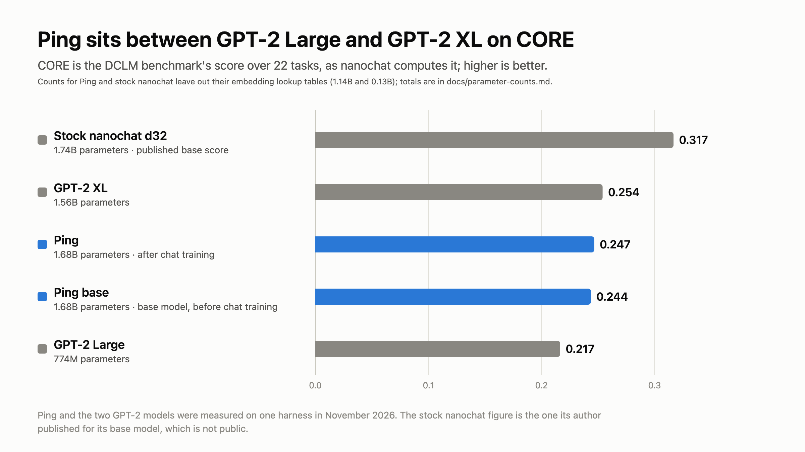
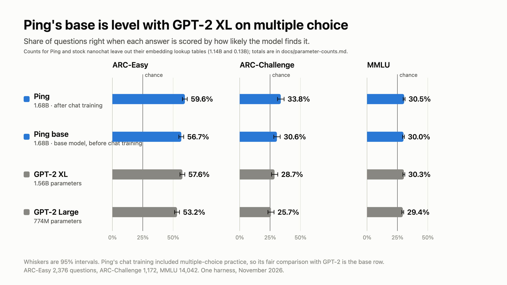
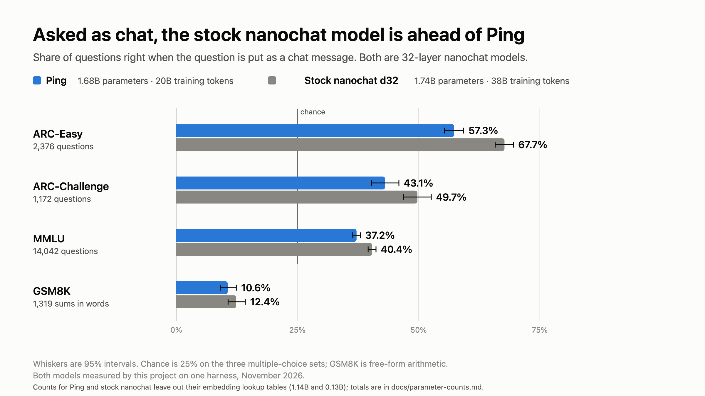
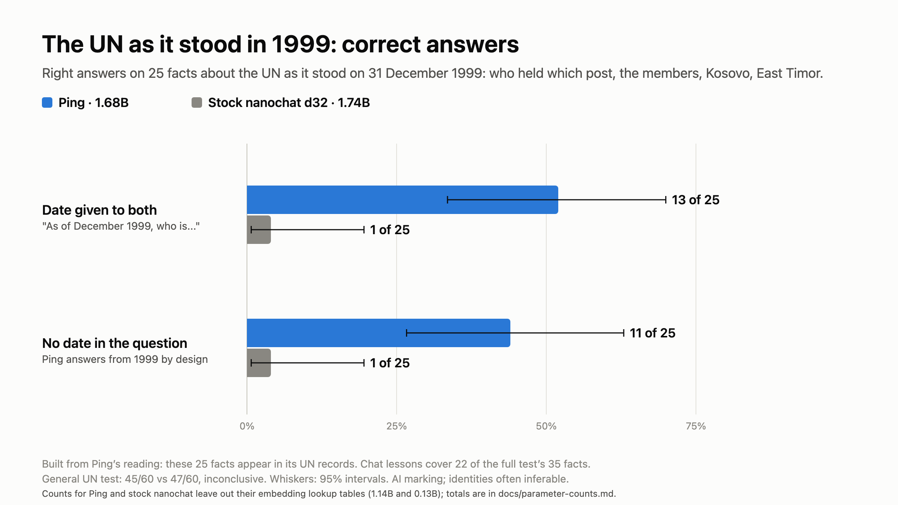

# Meet Ping, a small language model from 1999

**[Try the demo](https://www.ping1999.com) · [Weights on Hugging Face](https://huggingface.co/onlatentstates/ping) · [Model card](docs/model-card.md)**

The year 2000 is still in the future. The Internet is something to be optimistic about. Kofi Annan is Secretary-General of the UN. Y2K is a few hours away.

That is where Ping lives: the last evening of 31 December 1999. Inspired by Andrej Karpathy’s [nanochat](https://github.com/karpathy/nanochat), I wanted to see whether I could build a small language model that felt like a conversation with that moment—its interests, its blind spots and its misplaced confidence.

Ping’s base model was trained from scratch using nanochat, with its own weights and tokenizer. It has **1.68 billion parameters** (2.82 billion counting its embedding lookup tables) and was trained on **20.1 billion tokens** of text published by the end of 1999.

Three things to know before you start.

The time capsule isn’t airtight. Everything the base model read was published by the end of 1999, but teaching it to chat took modern examples: conversations written for it by Qwen3.8-Flash-Next, and SmolTalk conversations screened for anachronisms. Now and then, the present slips through.

This is a fun experiment, not a serious assistant. Stock nanochat is the better conversationalist: it scores higher on every chat benchmark below, and its replies are fuller. Ping also hallucinates, as you’d expect from a model of GPT-2’s size.

Ping reflects the culture and values of the texts it was trained on, not the views of its creator.

## Finding enough of the past

This is harder than it looks. Ping needed billions of words, all of them published by the end of 1999. The internet is full of the 1990s, but mostly in hindsight. The biggest obstacle, though, is copyright.

Most of what was written in Ping’s own decades still belongs to somebody. Nearly every English-language newspaper and magazine from the 1970s onward is still in copyright, and so are most books from the second half of the century. That rules out a huge share of the text that recorded those years as they happened. Even the Library of Congress’s free newspaper archive, which most of Ping’s newspapers come from, stops at 1963, because American papers published after that are generally still in copyright.

What is left makes for an odd diet. Government and parliamentary records are plentiful and mostly free to use. Old books and newspapers are largely out of copyright. The everyday voice of the 1980s and 1990s survives in bulk on Usenet, the period’s public discussion groups. For late-century journalism, fiction and speech, Ping has licensed research samples: [COCA](https://www.english-corpora.org/coca/) for American English of the 1990s (newspapers, magazines, fiction, academic journals, and transcripts of television and radio talk), and the British National Corpus for British English. So it has read a great deal of Hansard, Congress and Usenet, and very little 1990s journalism.

Scans have mistakes and websites disappear, too. In the end the corpus came from about 70 sources: public-domain material, openly licensed collections and some restricted ones. It holds about **14 billion tokens** of distinct text. The scarcer and more conversational material was read more than once and the largest collections were sampled, which is how 14 billion became the 20.1 billion tokens the base model trained on.

What counted was when the words were published, not when a file was scanned or downloaded. A modern introduction to an old book was cut, and anything I could not date was left out.

| What Ping read | Dates or editions selected | Examples |
|---|---|---|
| UN speeches and records | 1946–1999 | General Assembly General Debate speeches; Security Council records |
| Parliamentary and government publications | Published by 1999; Irish debates from 1919 | Hansard, Oireachtas, US government publications, Foreign Relations of the United States |
| Newspapers | American Stories: 1920–1963; other selected issues by 1999 | American Stories; headlines and opening lines from old Singapore papers |
| Informal discussion | Posts dated by 31 December 1999 | Usenet groups discussing everyday life, computers, entertainment and other interests |
| Books and language corpora | Books published by 1999; COCA’s 1990–1999 texts | Institutional Books, Project Gutenberg, [COCA](https://www.english-corpora.org/coca/) (spoken, fiction, magazines, newspapers, academic journals), [British National Corpus](https://www.natcorp.ox.ac.uk/) |
| Science and technical writing | Published by 1999; arXiv abstracts from 1991–1999 | PubMed, PubMed Central, arXiv, NASA, USGS, patent text |
| Reference works | Britannica’s 1910–1911 edition; encyclopedias from 1999; other selected text published by 1999 | Encyclopedias, reference books and country studies |
| Code and documentation | Releases dated by 1999 | Operating-system and language sources, software manuals |
| History, poetry and law | Works published by 1999 | Singapore and Malaya books, Gutenberg poetry, case law |

And by share of what the base model read:

| Kind of text | Share of the training text |
|---|---:|
| Usenet discussion | 23.2% |
| Government and parliamentary records | 23.1% |
| Books and language corpora | 17.8% |
| Science and medicine | 12.0% |
| Newspapers | 10.4% |
| Reference works and UN records | 4.4% |
| Patents | 3.0% |
| Code and documentation | 2.0% |
| Verse, case law and geological surveys | 4.1% |

COCA and the British National Corpus are counted under books and language corpora, though both also hold newspapers, magazines, academic writing and transcribed speech.

The corpus and my lesson files are not distributed.

### What’s missing

The biggest gaps are some of the things the era is best remembered for:

- **Films and television.** No subtitles or broadcast archives. COCA adds transcripts of 1990s news and talk shows and about 220 screenplays, but Ping knows the decade’s films and sitcoms mostly second-hand, from reviews and Usenet arguments.
- **Song lyrics.** No lyrics sites, and the Usenet group where fans posted lyrics was left out. Ping knows the decade’s songs mostly from people talking about them.
- **Big newspapers.** No newspaper archives from the 1970s on. Ping’s 1990s journalism is largely the newspaper and magazine samples in COCA and the BNC, and most of its newspapers are American papers from before 1964.
- **Modern books.** The bestsellers of Ping’s own decades are still in copyright. Its books are mostly old ones; later books reach it mainly through government publications and the samples in COCA and the BNC.
- **The web.** Old websites aren’t available in bulk, so Ping read almost none of the 1990s web. Usenet is the closest it gets.

## Teaching a reader to hold a conversation

The base model learned language the way nanochat teaches it: by reading. It trained for **9,600 steps**, with a tokenizer of **32,768 tokens** and **32 layers**. By the end it had read books, debates, newspapers and a great deal of Usenet, but being well read did not make it good company. It still had to learn to chat.

That took two stages. First came SmolTalk conversations screened for anachronisms, a set of identity lessons, and maths and multiple-choice exercises. Then came a final pass over **113,634 rows**: conversations written for Ping, more SmolTalk, and exercises from GSM8K, MMLU and ARC.

Qwen3.8-Flash-Next wrote the conversations for Ping, working from fact cards and pre-2000 source material. They taught things like answering a question about a name, keeping track of a correction, admitting it does not know, and behaving as a program in 1999. Checks removed copying, factual errors and other unwanted behaviour, though they did not catch everything.

I built Ping with Claude Code, which wrote the code and ran the project day to day: the data pipeline, the training runs and the evaluations. No output from Claude was used to train Ping itself.

One trade-off never went away. More confident answers sometimes meant more confident inventions. A fuller reply gave Ping more room to say something interesting, and more room to add a detail it had made up. Teaching it a fact was easy; teaching it when to keep quiet was not.

Training the base model took about 33 hours on four H100 GPUs, and the two chat stages 31 minutes on four H100s and 13 minutes on one H200, all rented from RunPod.

## How does Ping compare?

I measured general language ability, multiple-choice answers, chat-format answers and conversation behaviour separately. They tell different stories.

Ping is the same shape as stock nanochat d32: 32 layers, 2,048 wide. Its network has **1.68B** parameters and stock nanochat’s **1.74B**; **GPT-2 Large** has 774M and **GPT-2 XL** 1.56B. Those figures leave out embedding lookup tables, which are read by index rather than computed with. Counting them, Ping totals 2.82B and stock nanochat 1.88B: Ping was trained with a later version of nanochat that adds large per-layer tables ([counts and sources](docs/parameter-counts.md)).

Ping’s chat training included practice questions from ARC, MMLU and GSM8K. They came from MMLU’s auxiliary_train split and the training splits of GSM8K and ARC, and rows found to overlap the benchmarks’ test questions were removed. Every score below is on the test splits.

### General language ability



CORE is the DCLM benchmark’s score over 22 tasks, as nanochat computes it. Ping scored **0.247**, between GPT-2 Large (**0.217**) and GPT-2 XL (**0.254**). Its base model scored **0.244**. Stock nanochat d32’s **0.317** is the figure its author published for his base model; that checkpoint is not public, so I could not measure it myself. The Ping and GPT-2 figures were measured in this project. As a check on my setup, nanochat’s own reference figure for GPT-2 XL is 0.257.

### Multiple choice



Here the model scores how likely each candidate answer is, rather than writing a reply.

| Model | ARC-Easy | ARC-Challenge | MMLU |
|---|---:|---:|---:|
| Ping’s base model | 56.7% | 30.6% | 30.0% |
| GPT-2 XL | 57.6% | 28.7% | 30.3% |
| GPT-2 Large | 53.2% | 25.7% | 29.4% |
| Ping after chat training | 59.6% | 33.8% | 30.5% |

Ping’s **base model** is the fairer comparison with GPT-2, because the chat model went on to practise multiple-choice questions. On these measurements the base model is broadly level with GPT-2 XL. Scored this way, Ping and GPT-2 alike barely beat chance on the two harder tests, ARC-Challenge and MMLU: guessing at random would score about 25%. I did not measure stock nanochat this way.

### Questions asked as chat



| Model | ARC-Easy | ARC-Challenge | MMLU | GSM8K |
|---|---:|---:|---:|---:|
| Ping | 57.3% | 43.1% | 37.2% | 10.6% |
| Stock nanochat d32 | 67.7% | 49.7% | 40.4% | 12.4% |

Both were measured here, and stock nanochat is ahead on every row. My figures for it are within half a point of the ones its author published (68.0%, 49.9%, 40.5% and 12.7%). The two models differ in their text, training budgets, tokenizer and chat training, so the gap cannot be put down to the date cutoff alone.

It shows in conversation too. On the 70 questions of the dated UN test below, Ping’s replies averaged 22 words and stock nanochat’s 44.

## A small detour through the United Nations

I included UN General Assembly speeches from **1946 to 1999**, alongside Security Council records, and wanted to see whether that reading gave Ping a recognisable sense of the UN of its time.

On a broad **60-question test of pre-2000 UN knowledge**, Ping got **45** right and stock nanochat **47**. By the rule I fixed before the test, that is too close to call. On general UN knowledge the two are level.

A narrower question was whether each model could answer about the UN **as it stood in December 1999**: who held the offices, how many members there were, and what had or had not happened yet.



With the date given to both models, **Ping got 13 of 25 right; stock nanochat got 1**. Stock usually gave a later answer. A second pass, with sampling, gave **10 versus 2**.

Ping had home advantage. The questions were built from **its own reading**, and its chat lessons had taught 22 of the test’s 35 facts outright. So this shows a model with a particular historical point of view, not proof that the speeches alone did it. Ping still missed 12 of the 25.

One more result, on **287 passages of 1990s UN speeches** that were held out of training. Measured in bits per byte, where lower is better, Ping’s base model scored **0.620**, ahead of GPT-2 XL’s **0.719** and the stock nanochat chat model’s **0.712**. After chat training, Ping scored **0.752**: learning to chat had made it worse at predicting that kind of text.

## Limitations

I like asking Ping what the Internet might become, whether Y2K deserves the worry, or what it wants to know about 2026. That is the experience I wanted to share. It is also quite capable of confidently inventing a person, and then losing track of a real one it was just told about.

- **Gaps in its knowledge show.** Ping has read a lot, but unevenly, and it can’t always tell what it doesn’t know. Ask about something it never read and it may well make something up. Told the Berlin Wall fell in 1991, it agreed, then mentioned 1989. Asked about the latest iPhone, it described one.
- **It can be talked out of 1999.** In an ordinary chat it stays put. Push hard enough, especially with technical questions, and the present starts to leak in. A determined visitor can even convince it that it’s some other assistant.
- **It can’t do sums in its head.** When the demo’s calculator spots a sum, it hands Ping the answer. When it doesn’t, Ping usually gets the sum wrong. The downloadable weights have no calculator.
- **It’s terse, and a little forgetful.** Ask stock nanochat something and you get a paragraph; ask Ping and you get a sentence or two. It also loses the thread: give it a few things to keep in mind and it will usually drop one.

## Trying Ping

The demo is at [ping1999.com](https://www.ping1999.com). It is planned to close at the end of **31 December 2026, Singapore time**. A visit lasts ten turns. Chats are recorded for my review without the visitor’s address and deleted 90 days after closure. **Visitors’ chats are never training text.** Please avoid personal information.

The weights are on [Hugging Face](https://huggingface.co/onlatentstates/ping) under **CC BY-NC 4.0** (non-commercial), ungated. The code in this repository is MIT licensed. The corpus and private lessons are not distributed. Reproducing the identical model would require independent access to restricted data.

This repository contains the write-up, charts and [inference helper](ping_chat.py). The model weights and the tokenizer are in the Hugging Face repository. The [release manifest](docs/release-checkpoint.json) identifies the exact frozen checkpoint.

A clean-room check loaded the weights using public nanochat at commit `92d63d4`, without project patches. To run Ping yourself (install [uv](https://docs.astral.sh/uv/getting-started/installation/) first):

```bash
uv tool install huggingface_hub
hf download onlatentstates/ping --revision frozen-2026-11-18 --local-dir ./ping-release
python3 ./ping-release/verify_release.py

export NANOCHAT_BASE_DIR="$(cd ./ping-release && pwd)"
git clone https://github.com/karpathy/nanochat
cd nanochat
git checkout 92d63d4e8bb4df75c3b71618f31ddde2378b2bcd
uv sync --extra gpu
uv run python "$NANOCHAT_BASE_DIR/ping_chat.py" --check
uv run python "$NANOCHAT_BASE_DIR/ping_chat.py"
```

Keep the snapshot’s folders as they are; the script expects `chatsft_checkpoints/ping/` and `tokenizer/`. The wrapper adds Ping’s date/persona line and sampling settings. It does **not** add the demo’s calculator, spelling hint, moderation or guard. The [model card](docs/model-card.md) has the exact layout, hashes and limitations.

**Memory.** The verified route is a CUDA GPU with at least 24 GB free: the load peaked at 21 to 22 GiB, because nanochat’s loader briefly holds the model twice. It has also run on a 16 GB Apple Silicon Mac mini, more slowly; that route and smaller graphics cards were not part of the release check.

## Acknowledgements

- **[nanochat](https://github.com/karpathy/nanochat), by Andrej Karpathy:** the training code, used with this project’s changes, and the stock [karpathy/nanochat-d32](https://huggingface.co/karpathy/nanochat-d32) checkpoint used for comparison.
- **[Qwen3.8-Flash-Next](https://huggingface.co/Qwen/Qwen3.8-Flash-Next)**, which wrote the custom conversation examples under the Qwen Community Licence, and **[Qwen3Guard-Stream-4B](https://huggingface.co/Qwen/Qwen3Guard-Stream-4B)**, the demo’s moderation filter (Apache 2.0).
- **[SmolTalk](https://huggingface.co/datasets/HuggingFaceTB/smoltalk), [MMLU](https://github.com/hendrycks/test) and [GSM8K](https://github.com/openai/grade-school-math):** the datasets in nanochat’s chat recipe. Ping also used [ARC](https://huggingface.co/datasets/allenai/ai2_arc) exercises.
- **The publishers and archives** that preserved and made available the historical collections. The [source notes](docs/sources.md) carry their attributions and data terms.
- **Mark Davies**, creator of [COCA](https://www.corpusdata.org), the Corpus of Contemporary American English. COCA’s 1990s texts are nearly 4% of what the base model read, and Ping’s widest sample of how American English was spoken and written in that decade.
- **The [Institutional Data Initiative](https://institutional.org/institutional-books)**, whose Institutional Books collection, drawn from Harvard Library, is about a tenth of what the base model read and more than half of its books.

For another approach to historical language models, see [Talkie](https://talkie-lm.com/introducing-talkie). Its approach inspired and shaped this project.

If you try Ping, I’d be interested in the conversation you wanted to have, where it worked, and where it stopped making sense. Suggestions are welcome in [GitHub Issues](https://github.com/DLiang-pub/ping/issues).
